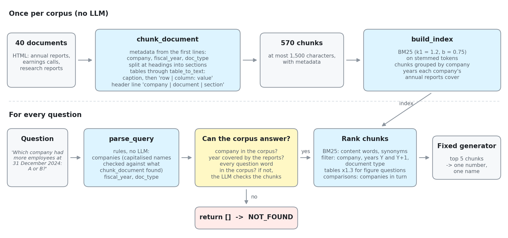

# FTEC5660 Homework 4

## Homework 4 solution

On `public_test`, the submitted `hw4.py` scores the full 75 estimated points of Tasks 1 to 4 ([results.csv](results.csv)):

| Task | 1.1 tables | 1.2 chunks | 2.1 valid | 2.2 parsing | 2.3 recall@5 | 3 abstention | 4 accuracy |
|---|---|---|---|---|---|---|---|
| Measure | 100% of cells | 40/40 documents | 46/46 | 100% of fields | 46/46 | kept 46/46, rejected 14/14 | 60/60 |
| Points | 8 | 7 | 5 | 10 | 15 | 10 | 20 |

A run takes about 20 seconds. Our own LLM calls are four (the answerability check below), and the generator's cost is about USD 0.01.

### Pipeline

**Parsing and chunking.** `chunk_document` reads the company, fiscal year and document type from the first lines of each document (the `<h1>` name without its legal suffix, "Annual Report 2025", "Full Year 2025 ... Earnings Conference Call", "FY2025 results review") and walks the HTML in reading order. Every table goes through `table_to_text`, which writes the caption (it holds the unit), then one line per row, `Revenue | 2025: 2,710.4 | 2024: 2,629.1`, so that every value stays on a line with its row and its column; a section row such as "Current assets" gets its own line, because a line must not contain another row's label. Chunks follow the headings: one section is one chunk, a section shorter than 250 characters joins the next section of the same part, and a table longer than a chunk (the balance sheet, about 1,600 characters) is split before a section row, with its caption repeated. In an earnings call, each speaker's name is joined to what they said. Every chunk starts with a header line such as `Northgate Robotics | Annual report FY2025 | 6. Financial statements > Consolidated balance sheet`, because a section on its own rarely names the company. **Index and retrieval.** `build_index` is BM25 over stemmed tokens. `retrieve` parses the question with rules (`parse_query`): the companies are the capitalised names that match, or look like, the companies `chunk_document` found, and the year and document type come from patterns ("FY2024", "31 December 2024", "earnings call", "target price"). Only the chunks of the named companies, of the reports that contain the year asked about (the FY Y and FY Y+1 annual reports) and of the document type asked about are ranked. The BM25 query keeps the content words of the question with synonyms and expanded abbreviations; table chunks count 1.3 times when the question asks for or compares figures; and in a comparison the companies take turns, so that the first two chunks are one per company. **Abstention.** `retrieve` returns `[]` when a named company is not in the corpus, when the annual reports do not cover the year asked about, or when a word of the question occurs nowhere in the corpus (lobbying, churn) and the LLM, shown the top chunks, confirms that they do not answer the question. **Why.** BM25 cannot tell Northgate Robotics from Northgate Payments, or 2024 from 2025, because every report mentions both; metadata can, so the metadata does the selecting and BM25 only orders the chunks of the right documents.

### Ablation

[ablation.py](ablation.py) turns on the switches of `hw4.SETTINGS` one at a time. Row B0 is the naive baseline of the handout: the text from BeautifulSoup's `get_text()`, `RecursiveCharacterTextSplitter` (chunk size 1,500, the limit of the runner, and overlap 200 as in Tutorial 7; the default size of 4,000 would be dropped by the runner), the required metadata, BM25 top-5 with lower-cased whitespace tokens over the whole corpus, no query parsing and never `[]`. Each following row changes one thing relative to the row above, and V9, with every switch on, is the submitted `hw4.py`. Every row is a full run of the unchanged runner on `public_test`; its `results.csv` and output are in [ablation/](ablation/) (`B0.csv` to `V9.csv`, the table is [ablation/ablation.md](ablation/ablation.md)). Tasks 1.1, 1.2 and 2.2 do not change between rows (8, 7 and 10 points in every row), so the last column counts Tasks 2.1 to 4 only.

| Row | Change relative to the row above | Recall@5 | Kept | Rejected | Fact | Table | Comparison | Unanswerable | Accuracy | Points 2.1 to 4 (of 50) |
|---|---|---|---|---|---|---|---|---|---|---|
| B0 | Naive RAG (see above) | 34.8% | 100% | 0% | 67% | 23% | 33% | 86% | 48.3% | 14.67 |
| V1 | Tables through `table_to_text` | 37.0% | 100% | 0% | 67% | 27% | 25% | 100% | 51.7% | 15.33 |
| V2 | Chunks follow the headings instead of fixed-size pieces | 23.9% | 100% | 0% | 67% | 9% | 17% | 93% | 41.7% | 13.33 |
| V3 | Header line in every chunk: company, document, section | 60.9% | 100% | 0% | 75% | 45% | 83% | 86% | 68.3% | 22.74 |
| V4 | Tokeniser: no punctuation, light stemming, British spelling | 73.9% | 100% | 0% | 92% | 55% | 92% | 86% | 76.7% | 29.30 |
| V5 | Query: content words only, with synonyms and abbreviations | 84.8% | 100% | 0% | 100% | 91% | 58% | 86% | 85.0% | 35.04 |
| V6 | `parse_query` and metadata filter: company, year, document type | 100% | 100% | 0% | 100% | 100% | 100% | 100% | 100.0% | 40.00 |
| V7 | Comparisons: the companies take turns | 100% | 100% | 0% | 100% | 100% | 92% | 100% | 98.3% | 39.67 |
| V8 | Table chunks x1.3 when the question asks for or compares figures | 100% | 100% | 0% | 100% | 100% | 100% | 100% | 100.0% | 40.00 |
| V9 | Abstention: unknown company, uncovered year, unknown word with LLM check | 100% | 100% | 100% | 100% | 100% | 100% | 100% | 100.0% | 50.00 |

Recall@5 is over the 46 answerable questions; Kept and Rejected are the two shares of Task 3; the category columns and Accuracy are the generator's answers (Task 4). One question is 1.7% of the accuracy, and the generator does not always give the same answer to the same chunks (see the error analysis), so a difference of one question between two rows is within its variation.

**What each change did, and why.**

- **V1, `table_to_text` (+2.2 points recall, +3.4 accuracy).** A small gain, because the baseline mostly fails before it reads a table: in 30 of its 46 answerable questions the five chunks miss the evidence. In 7 of them a named company is missing from all five chunks, in 3 the company is right but the document or year is wrong, and in 20 the right report is found but not the chunk with the figure. Turning a table into `row | column: value` lines helps the generator read the chunk once it is there, but it cannot bring the chunk there. The two unanswerable questions B0 answered with a number (q001 "Northgate Robotic Systems", answered with Northgate Robotics' cash; q044 "Orchid Bay Resorts", answered with Orchid Bay Hotels' operating income) were the generator's choice on similar chunks; no row before V9 returns `[]`.
- **V2, chunks follow the headings (recall 37.0% to 23.9%).** Worse. A section is smaller than a 1,500-character window and most sections never name the company: the balance sheet chunk is only figures under "Consolidated balance sheet". BM25 can no longer tell whose balance sheet it is, and table questions fall to 1 of 22. The section structure is kept because of V3.
- **V3, a header line in every chunk (recall 60.9%, accuracy 68.3%).** The largest gain of the chunking steps (+37 points recall over V2, +24 over V1): every chunk now names its company, document, fiscal year and section, so the clean sections of V2 become findable, and the generator also sees which report a chunk comes from.
- **V4, tokeniser (recall 73.9%, accuracy 76.7%).** Whitespace tokens keep punctuation, so the question's "Robotics'" never matches the documents' "Robotics", the question's "2025," never matches the table line's "2025:", and the documents' "receivable," never matches the question's "receivable"; stemming also joins "borrowing" and "borrowings", "employee" and "employees".
- **V5, content words, synonyms and abbreviations (recall 84.8%, accuracy 85.0%).** Dropping the question words (what, did, much, USD, millions) leaves the words that matter, and the synonyms reach the documents' wording (cash and cash equivalents, headcount and employees, CFO and Chief Financial Officer). Table recall rises from 13 to 20 of 22. Comparison recall falls from 10 to 7 of 12: with the question words gone, the two company names weigh more in the query, and the research reports' peer tables, which list several companies in one chunk, take the first places.
- **V6, `parse_query` and the metadata filter (recall 100%, accuracy 100%).** The company, the year and the document type become filters instead of BM25 terms. This is the step that separates Northgate Robotics from Northgate Payments and 2024 from 2025, and it also removes the peer-table problem of V5.
- **V7, the companies take turns (accuracy 98.3%).** No change in recall: after the filter, both companies were already among the five chunks. One comparison became wrong, q013 (higher net income in FY2024, Brightwater Energy or Orchid Bay Hotels). Without turns, four of its five chunks were Orchid Bay Hotels' and the fifth was Brightwater Energy's management discussion. With turns, the first two chunks were the two management discussions, which give the operating margins (Orchid Bay Hotels' is higher, 24.5% against 22.8%) before the net income, and the generator answered Orchid Bay Hotels. Turns are kept because they guarantee that both companies are present, which a filter alone does not; V8 fixes the order.
- **V8, table chunks first for figure questions (accuracy 100%).** The boost used to apply only to questions with a unit ("in USD millions"); comparisons ("higher net income", "more employees") now count as figure questions too, so the first two chunks of every comparison are the two companies' statements, and q013 is right again.
- **V9, abstention (Rejected 0% to 100%, Kept stays 100%, +10 points).** The 14 unanswerable questions are 5 companies that are not in the corpus, 5 years that the reports do not cover (FY2021, FY2022) and 4 figures that are not disclosed (lobbying expenses, carbon offset purchases, the largest single customer, customer churn). The first two kinds are rejected by the rules; for the four undisclosed figures, a question word does not occur anywhere in the corpus, and the LLM check, shown the top chunks, said NO each time. Accuracy does not change, because in V8 the generator already answered these questions with NOT_FOUND; what changes is Task 3.

### Error analysis

- **Submitted pipeline.** No error in [results.csv](results.csv), and none in three more runs of the same code ([ablation/stability/](ablation/stability/)): 60 of 60 each time. Retrieval is deterministic (no randomness, and the retrieved documents of every question are identical across runs); the only answer that differed was a format, 2711.4 against 2,711.4, and both are correct.
- **The generator varies.** In an earlier version, q013 was answered correctly in one session and wrongly in five runs of another, with identical chunks. Its answer depended on which chunks came first: the management discussion, with operating margins, before the income statements. This was the only error of the final versions and is fixed by putting the statements first (V8); it is also why single-question differences in the ablation are not significant.
- **Baseline errors** fall into the types the handout warns about: similar names (BM25 cannot separate "Northgate" and "Brightwater" companies), two years per report, look-alike companies that are not in the corpus (q001, q044), and tables whose values lose their labels. V3 to V6 remove them in turn.
- **Does it generalise?** The private set has other companies and wording, so we wrote 29 more questions on the public corpus in other words ([tests/paraphrase_check.py](tests/paraphrase_check.py), no API calls): "headcount", "price target", "What FY2027 revenue does the broker project", "Between A and B, which", abbreviations (R&D, EPS, capex) and American spelling, and new unanswerable questions (FY2020, a FY2030 forecast, "Sablewood Retail Group", "Pemberton Freight"). Parsing is right for all 29 and retrieval or abstention for 28. Writing them found three faults that the public questions did not show, all fixed before the runs above: "R&D" was taken for a company, "previous" and "broker" were taken for undisclosed figures (now the LLM check confirms such cases), and a repurchase programme asked about without naming the call was not found (now the best chunk of another document type is added when it matches much better).
- **What can still fail.** (1) An undisclosed figure whose words do occur in the corpus: "How much did Northgate Robotics spend on employee training?" is not rejected, because "training" appears in the risk factors; the generator then has to answer NOT_FOUND itself, which costs Task 3 but not Task 4. (2) Company names are found as capitalised words; a company written in lower case would be missed. (3) The synonym list and the 1.3 factors were chosen on the public questions; other wording may need other synonyms.

### Files

| File | What it is |
|---|---|
| [hw4.py](hw4.py) | The five functions and their helpers; `SETTINGS` holds the switches of the ablation, set to the submitted pipeline |
| [ablation.py](ablation.py) | Task 5: `python ablation.py` runs all ten rows (needs `DEEPSEEK_API_KEY`); `--no-generate` runs retrieval only, without API calls |
| [ablation/](ablation/) | `results.csv` and output of every row, the table, and three repeated runs of the submitted pipeline in `stability/` |
| [tests/paraphrase_check.py](tests/paraphrase_check.py) | The 29 questions in other words, without API calls |
| [docs/pipeline.png](docs/pipeline.png) | The pipeline figure |

The runs above were made on Colab with the packages of `requirements.txt`; no package was added.

## Task 6: Reflection

I am finishing an MSc in Artificial Intelligence. My research so far has been 3D reconstruction from endoscopic video, and my next direction is brain imaging. Most of the code in this homework, and in the other homework of this course, I wrote together with an AI coding agent. So the world in the question is already partly mine, and the answers below come from what I have seen while working this way.

**What kind of person I want to be.** Someone whose statements can be trusted, because they come with the evidence behind them. When an agent can produce code, plots and paragraphs in minutes, the scarce thing is no longer the output but the reason to believe it. In this homework, the agent wrote much of the retrieval code; my part was to decide what would count as proof. Every row of the ablation runs through the same unchanged runner, the last row has to be the submitted code, and after the code was reorganised for the ablation, the old and the new version had to return the same chunks for 89 questions before anything else went on. In an earlier project I built a receipt checker on the same idea: the model only reads the receipt, and plain code checks the arithmetic, because a model that checks its own work tends to agree with itself. I want to be the person who designs the check, not only the one who receives the answer.

**Which ambitions still matter.** Research that is useful in medicine, first in endoscopic video and next in brain imaging. What changes is why. If agents can write a paper, the number of papers stops meaning much. What still matters is finding out something true about images of real patients, and being the person who is accountable for that claim. A wrong reconstruction in an endoscope or a wrong prediction for a brain tumour is not a typo. Accountability cannot be handed to a tool, and that is the part of the ambition I want to keep.

**What I want to be known for beyond productivity.** For being honest about what did not work, and for being easy to think with. I would like colleagues to bring me a half-formed idea or a result that looks too good, knowing that I will take it seriously, check it with them, and tell them plainly what I find, including when the problem is in my own work. I would also like to be known for explaining things patiently, because an agent can answer a question, but it does not care whether the person in front of it has understood.

**What I am willing to struggle for.** Understanding. An agent can make a confusing result go away by rewriting the code until the number looks right; I want to stay with it until I know why it happened. One example changed how I work: a fluent paragraph in a draft of my own paper described one of my masks as two-sided, and the code did something else. Nothing in the text looked wrong. Only reading the code, line by line, showed it. I am willing to read the original paper instead of the summary, derive the equation instead of trusting it, and run the baseline myself, even when an agent could save me the afternoon. That slow work is what lets me notice when something is wrong.

**What will still make me valuable.** Judgement about a domain: knowing what a surgeon needs from a reconstruction, what a clinician would never accept, and which result is too good to be true. The habit of designing experiments that can fail, such as a test registered before the run or an ablation that changes one thing at a time. Taste in choosing the question, since agents are much better at answering than at deciding what is worth asking. And the willingness to sign my name under a result and answer for it.

**How I will define who I am.** By the questions I choose to spend my years on, by how carefully I answer them, and by how I treat the people around the work: the colleagues I build things with, and the patients whose images make medical research possible. What I can do will keep changing as the tools change. What I care about, and whether I keep my word, do not have to.

**What I will start doing differently tomorrow.** Three things. Before I accept a result from an agent, I will write down what would convince me that it is wrong, and check that first. I will read one paper a week in full, without a summary, starting with the papers for my next project. And I will write the first draft of the texts that matter, such as the papers I put my name on, myself, and use AI to criticise the draft rather than to write it.

*This reflection was drafted with an AI assistant from my notes and background, then edited by me; the views are my own.*
